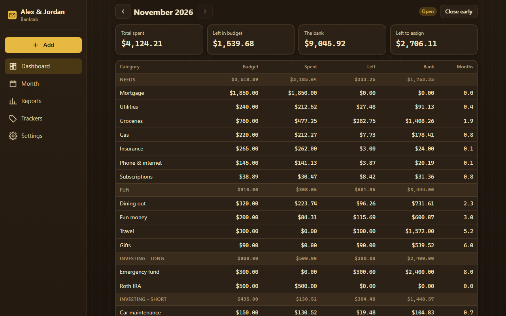
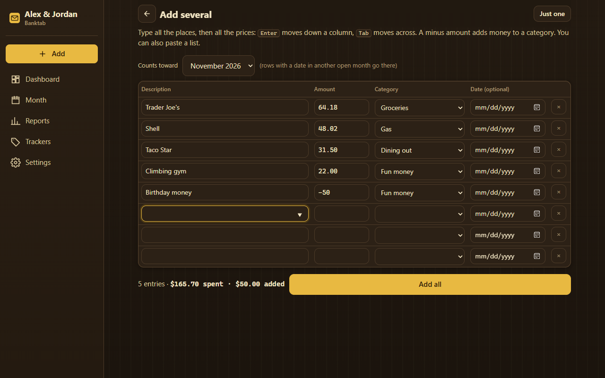
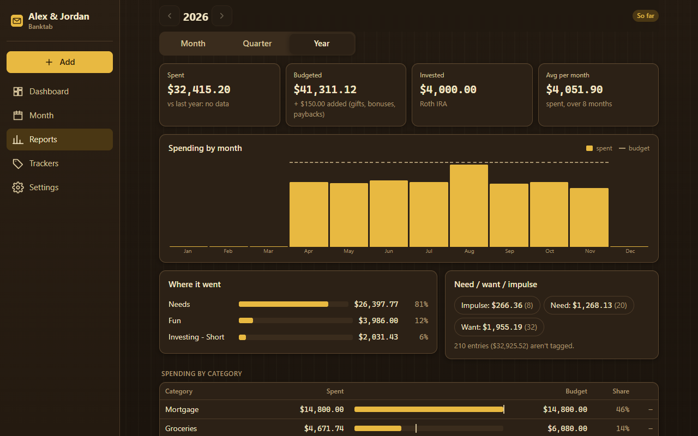
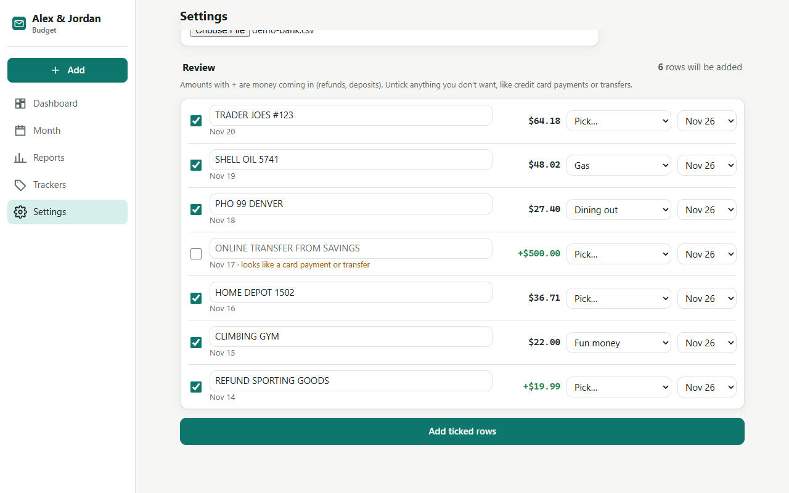
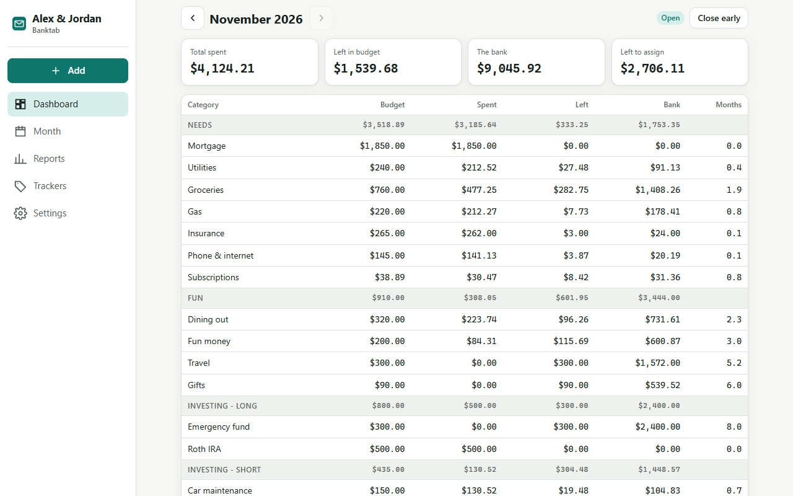
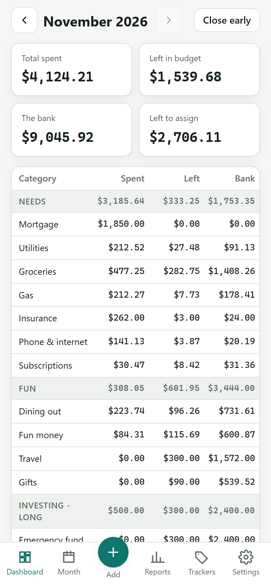
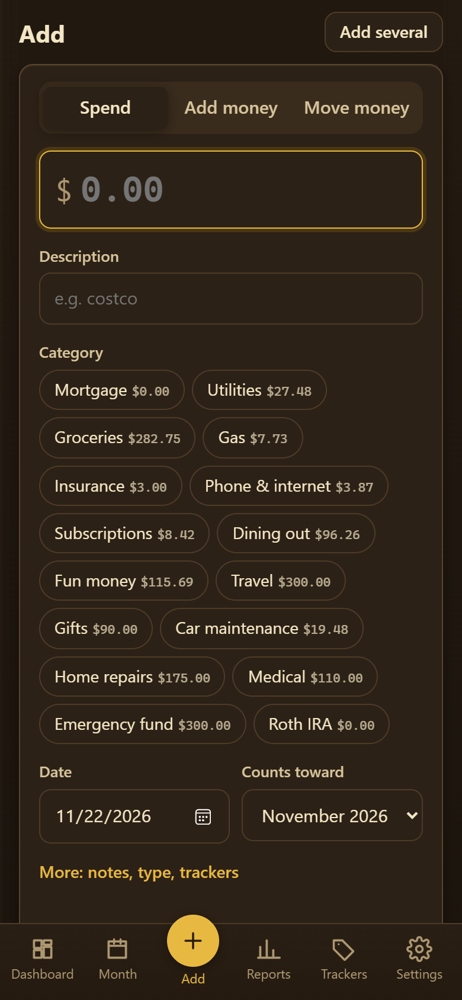
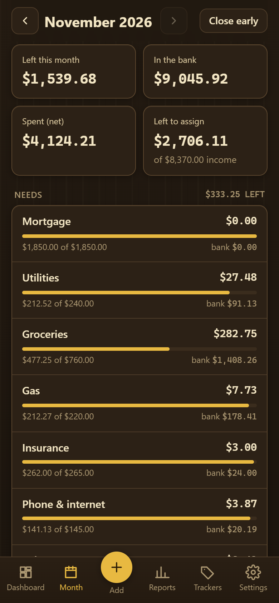

<p align="center"></p>
<h1 align="center">Banktab</h1>

<p align="center">
  <b>A self-hosted envelope budget for households.</b><br>
  Give every dollar a job, let what you don't spend roll over, and see where it all went.
</p>

<p align="center">
  <a href="https://github.com/pvonkalb/banktab/actions/workflows/ci.yml"></a>
  <a href="LICENSE"></a>
  
  
</p>

<p align="center"></p>

I built this to replace the Google Sheet my wife and I had budgeted with for four years. The
sheet worked, but closing a month meant copying formulas and pasting values by hand, it was
clumsy on a phone, and it couldn't answer simple questions like "what did we spend on food
this quarter?". Banktab keeps the same method (zero-based envelopes with rollover) and makes
the tedious parts one click. One server can host several households, each completely separate,
so friends and family can have their own.

Each category is a *tab* in your household's *bank*: money goes into the tabs at the start of
the month, and whatever's left in a tab stays there for later.

*Every screenshot here uses a made-up demo household. You can generate the same one with
`python tools/demo.py`.*

## Features

**Budgeting**
- **Envelopes that roll over.** Each category gets money every month; whatever isn't spent stays
  in its "bank" so you can save up for a vacation or a repair.
- **Closing a month** locks its entries and leftovers (with a one-step reopen), so changing next
  month's budget never rewrites history. Leave a month open until everything posts, or close it early.
- **Move money between envelopes** when one runs short, and **add money** for gifts and refunds.
- **Bills drive budgets:** monthly, quarterly and yearly subscriptions roll up into a monthly amount.
- **Due this month:** bills show up on the dashboard when they're due; one tap logs them (amount
  editable for bills that vary), or skip a month.

**Entering spending**
- **Quick add** with autocomplete: type "costco" and the category fills itself in.
- **Add several**: a spreadsheet-style grid for catching up on a week of card statements.
  <kbd>Enter</kbd> moves down a column, so you can type all the places, then all the prices.
- **Bank CSV import** (US Bank, Capital One and most banks): review every row first;
  already-logged rows and card payments are flagged so nothing is counted twice.

**Seeing where it went**
- **Dashboard** with every envelope's budget, spending and balance in one table.
- **Savings goals:** give a category a target ("$3,000 by June") and see progress, what's left,
  and the monthly amount needed to get there on time.
- **Reports** by month, quarter or year: trends against budget, by group and category,
  versus the previous period and the same period last year.
- **Trackers** for taxes and projects: tag house repairs or medical bills, get yearly totals and
  a CSV for tax time, tick off HSA reimbursements.

**Households**
- Several households per server, **each in its own database file**.
- Invite a partner by link; owners and members; sign-up with email confirmation; password reset.
- Optional **two-step login** with any authenticator app, plus one-time recovery codes.
- Six themes (Bank, the default: dark wood and gold; Match device, Light, Dark, Noir and Paper) and eight accent colors, per person.
- Installable on a phone (PWA), currency per household, CSV export and full-backup download.

<table>
  <tr>
    <td width="50%"><br><sub><b>Add several.</b> Catch up a week of spending in one go.</sub></td>
    <td width="50%"><br><sub><b>Reports.</b> Month, quarter or year, against budget.</sub></td>
  </tr>
  <tr>
    <td><br><sub><b>Bank import.</b> Every row reviewed; transfers and duplicates flagged.</sub></td>
    <td><br><sub><b>Themes.</b> Bank is the default; Light, Dark, Noir and Paper are a click away.</sub></td>
  </tr>
</table>

<p align="center">
  
  
  
</p>

## Quick start (Docker Compose)

```sh
git clone https://github.com/pvonkalb/banktab.git && cd banktab
cp .env.example .env              # optional: sign-ups, email, backups
docker compose up -d
docker compose logs banktab       # look for "setup code: XXXX-XXXX"
```

Open http://127.0.0.1:8000, enter the setup code and create the first account. It becomes the
owner of the first household; invite others from **Settings → Household**.

For use away from home, put it behind something that adds HTTPS: `tailscale serve` for private
use, or a Cloudflare Tunnel / Caddy to share it with friends. The container only listens on
127.0.0.1:8000. Never publish port 8000 to the internet directly.

**Just want to look around?** Load the demo household instead:

```sh
python -m venv .venv && .venv/bin/pip install -r requirements.txt     # Windows: .venv\Scripts\
.venv/bin/python tools/demo.py                                         # prints a login
BUDGET_DATA_DIR=demo-data .venv/bin/python -m uvicorn app.main:app --port 8000
```

## How it works

```
Browser (plain JS, no build step)  ──HTTPS──▶  FastAPI  ──▶  data/accounts.db          logins, households, sessions
  installable PWA, strict CSP                    │                                       one-time links (hashed)
                                                 └────────▶  data/households/<id>.db    one household's budget
```

- **One SQLite file per household.** A query can only ever see the household it opened, so one
  household's data can't leak into another's. Backing up, exporting or deleting a household is a
  single file. The budget logic in `app/core.py` has no idea other households exist.
- **Money is integer cents.** Positive = money out of an envelope, negative = money in. Every
  envelope balance is the sum of (budget − spent) over all months up to now.
- **Each month keeps its own copy of every budget**, copied from the defaults when the month opens.
  Changing a default updates open and future months only, which is what makes closing a month safe.
- **The front end** is ~2,000 lines of plain JavaScript that builds the DOM with `textContent`
  only (never `innerHTML`), so nothing a user types can become markup.

## Security

Built to be exposed to the internet by someone who isn't a security expert:

- A fresh install can only be claimed with a **one-time setup code** printed in the server log.
- Optional **two-step login** (TOTP, RFC 6238): codes can't be replayed, wrong codes are rate-limited,
  recovery codes are stored hashed, and email links (reset, confirm) never skip the second step.
- Passwords hashed with **scrypt**. Sessions are random tokens **stored hashed**, in HttpOnly,
  SameSite=Strict cookies that become HTTPS-only automatically over HTTPS.
- **Rate limits** per IP, per account (across any number of IPs), on sign-ups, resets and invites.
  Sign-up has a honeypot and a household cap; unconfirmed sign-ups expire after 7 days.
- **Every write, including login, needs a custom header**, which cross-site requests can't send.
- **Email links** (confirm, reset, invite) are one-use, short-lived, stored hashed, and built from
  a configured base URL rather than the request's Host header. "Forgot password" doesn't reveal
  whether an account exists.
- **Strict Content-Security-Policy**, HSTS, COOP/CORP, Permissions-Policy. No third-party
  scripts, fonts, analytics or trackers.
- CSV exports are **safe to open in Excel** (formula injection neutralized).
- The Docker image runs as a **non-root user on a read-only filesystem** with no Linux capabilities.
- CI runs the test suite (40+ tests, including cross-household isolation), `pip-audit` and a Docker build.

Found a problem? See [SECURITY.md](SECURITY.md).

## Configuration

All settings are optional environment variables (see [`.env.example`](.env.example)):

| Variable | Default | |
|---|---|---|
| `BUDGET_DATA_DIR` | `./data` (`/data` in Docker) | where `accounts.db` and `households/` live |
| `BUDGET_SIGNUP` | `closed` | `open` lets anyone create a household; invites work either way |
| `BUDGET_MAX_HOUSEHOLDS` | `100` | cap on sign-ups |
| `BUDGET_BASE_URL` | request URL | public address for emailed links; **required once email is on** |
| `BUDGET_SMTP_HOST`, `_PORT`, `_USER`, `_PASSWORD`, `_FROM` | unset | outgoing email; without it, links are printed to the log |
| `BUDGET_BACKUP_KEEP` | `14` | daily automatic backups kept in `<data>/backups`; `0` turns them off |
| `BUDGET_SECURE_COOKIE` | auto | `1` forces HTTPS-only cookies |
| `BUDGET_SOURCE_URL` | unset | link to this copy's source code, shown in Settings → Account |
| `FORWARDED_ALLOW_IPS` | `*` in Docker | proxies allowed to set `X-Forwarded-*` |

## Command-line admin

```sh
python tools/manage.py households | users                   # list
python tools/manage.py create-household "The Smiths"
python tools/manage.py adduser sam "Sam" 1 [--member] [--email sam@example.com]
python tools/manage.py passwd sam
python tools/manage.py disable-2fa sam                      # lost phone and recovery codes
python tools/manage.py delete-household 2
python tools/backup.py                                      # one-off backup of everything
python tools/demo.py --data demo-data                       # made-up demo household
```

With Docker, prefix these with `docker compose exec banktab`. Moving from a spreadsheet? Export
transactions as CSV and use **Settings → Import**.

## Development

```sh
python -m venv .venv
.venv/bin/pip install -r requirements-dev.txt
.venv/bin/python -m pytest -q tests
.venv/bin/python -m uvicorn app.main:app --reload --port 8000
```

| Path | |
|---|---|
| `app/core.py` | budget rules: months, envelopes, rollover, moves, locking |
| `app/accounts.py` | households, passwords, one-time links, email, backups |
| `app/main.py` | HTTP API, sessions, rate limits, security headers |
| `app/static/` | the whole front end: `app.js`, `styles.css`, service worker |
| `tools/` | admin CLI, backups, demo data |
| `tests/` | API, isolation, security and budget-logic tests |

## Roadmap

- Custom category groups and more languages
- Restore a downloaded backup from inside the app
- Bank sync via SimpleFIN

## License

[GNU AGPL-3.0](LICENSE). Use it, host it for others, change it. If you run a **modified** version
that other people use over a network, offer them its source (set `BUDGET_SOURCE_URL` and a link
appears in Settings → Account). Running it unchanged for your own household needs nothing extra.
